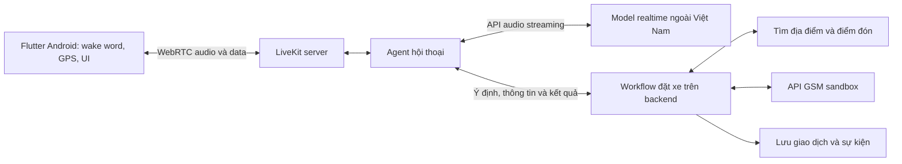

# Voice Assistant cho GSM — Thiết kế prototype Phase 3

**Trạng thái:** thiết kế POC theo phương án triển khai tạm thời đã thống nhất.
**Ứng dụng:** Flutter, ưu tiên Android.
**Truyền âm thanh:** LiveKit WebRTC.
**Lọc nhiễu:** thử `sherpa_onnx` trên Android, ưu tiên GTCRN và so sánh với DPDFNet.
**Suy luận:** model realtime qua API nhà cung cấp, dự kiến xử lý ở nước ngoài.
**Điều phối đặt xe:** workflow có trạng thái trên backend.

Tài liệu mô tả thiết kế đề xuất cho POC GSM. Trạng thái triển khai và kết quả
thực nghiệm cần được bổ sung từ prototype GSM; các giao diện tool dưới đây
là đề xuất.
Nhóm chưa có đủ hạ tầng GPU và nguồn lực vận hành để ưu tiên self-host model
realtime trong Phase 3, nên chọn API bên ngoài. Vị trí triển khai LiveKit/agent
và nhà cung cấp model cụ thể cần được xác định khi triển khai.

## 1. Bài toán và mục tiêu Phase 3

Xây dựng full prototype trợ lý giọng nói tiếng Việt hỗ trợ trọn luồng đặt xe:
đánh thức trợ lý → tiếp nhận yêu cầu → xác định điểm đón/đến → chọn dịch vụ
→ lấy báo giá → đọc lại và xác nhận → tạo chuyến → thông báo kết quả và
trạng thái tài xế.

Model phụ trách hiểu tiếng Việt, sửa thông tin và hội thoại. Workflow backend
quản lý thứ tự nghiệp vụ, điều kiện chuyển bước và giao dịch đặt xe.

Ưu tiên người lớn tuổi, người thị lực kém và người khó thao tác trên màn hình.
Phạm vi ban đầu: đặt xe ngay, một điểm đón và một điểm đến, tại địa bàn và
nhóm dịch vụ thống nhất với GSM. Người dùng có thể chuyển giữa nói và chạm.

Đầu ra gồm prototype Android, demo, mã nguồn, bộ kiểm thử và báo cáo thực nghiệm.
Phần mô phỏng phải được ghi rõ; tích hợp GSM chỉ được báo cáo khi đã kiểm thử
trên môi trường tương ứng. Chưa đưa đặt trước, đa điểm hoặc cá nhân hóa lịch sử
di chuyển vào phạm vi ban đầu.

## 2. Các thành phần cần triển khai

| Thành phần | Chức năng | Yêu cầu kiểm thử |
| --- | --- | --- |
| Wake word trên Android | Phát hiện câu đánh thức trên thiết bị khi chế độ trợ lý được bật. | Tỷ lệ bỏ sót, kích hoạt nhầm và độ trễ trong môi trường ồn. |
| Điều phối micro | Chuyển giữa chờ wake, kích hoạt và hội thoại; báo khi trợ lý sẵn sàng. | Bàn giao micro và giữ âm thanh đầu câu khi khách nói liền sau wake. |
| Audio và kết nối | Truyền audio qua LiveKit WebRTC, kết nối agent với API model realtime. | Nói chen, mất mạng, chuyển loa/tai nghe và khôi phục phiên. |
| Lọc nhiễu trên thiết bị | Thử streaming denoiser của `sherpa_onnx` với GTCRN và DPDFNet. | Độ chính xác địa danh/số nhà, mất lời nói, CPU, pin và độ trễ. |
| Foreground service | Hỗ trợ duy trì phiên đã bật khi app xuống nền theo giới hạn Android. | Tắt màn hình, app bị dừng và thu hồi quyền micro. |
| Vị trí | Lấy tọa độ, thời điểm đo và độ chính xác; hỗ trợ xác định điểm đón. | Cache cũ, GPS yếu, thiếu quyền và điểm đón khác vị trí thiết bị. |
| Workflow và tool execution | Kiểm tra yêu cầu, điều phối tác vụ, giữ trạng thái và kết quả có cấu trúc. | Kết quả về muộn, thao tác đồng thời, timeout và giao dịch trùng. |
| Tìm địa điểm | Trả danh sách ứng viên và làm rõ địa điểm/điểm đón. | Tên trùng, nhiều cổng, địa chỉ nghe sai và không có kết quả. |

### Các điểm cần xác minh trên prototype

- **Vị trí cache:** chỉ dùng khi đạt yêu cầu về độ mới và độ chính xác.
- **Địa điểm mơ hồ:** có bước làm rõ; không tự chọn kết quả đầu tiên.
- **Âm thanh ngay sau wake:** giữ và bàn giao đầu câu, không gửi trùng audio.
- **Denoising thực tế:** so sánh bộ lọc mặc định, GTCRN và DPDFNet trên
  từng thiết bị và tuyến âm thanh; chưa khẳng định phương án nào tốt hơn.
- **Audio quá tải:** đo frame bị bỏ và ảnh hưởng tới nhận diện địa danh.
- **Tool song song:** chỉ chạy đồng thời thao tác độc lập; kiểm tra phiên bản chuyến.
- **Timeout:** lưu trạng thái giao dịch và đối soát với GSM trước khi gửi lại.

## 3. Kiến trúc đề xuất

### Phân chia trách nhiệm

- **Flutter và lớp Android native:** wake word trên thiết bị, micro, lọc nhiễu,
  GPS, audio route, UI và thao tác chạm. Lọc bằng runtime native của
  `sherpa_onnx`; phần điều phối không chặn UI và vòng xử lý audio.
- **LiveKit:** truyền audio và data giữa app và agent; có thể dùng Cloud hoặc
  self-host độc lập với lựa chọn model. Hạ tầng này không cần chạy model lớn.
- **Agent hội thoại:** nhận/phát audio qua LiveKit, kết nối API model, chuyển
  yêu cầu có cấu trúc và kết quả giữa model với workflow.
- **Model realtime:** hiểu yêu cầu và tạo phản hồi tiếng Việt; được gọi qua API.
- **Workflow backend:** xác thực, giữ trạng thái chuyến, kiểm tra điều kiện,
  chọn bước tiếp theo và thực hiện các API địa điểm/đặt xe.

Thông tin được hiểu qua model phải được kiểm tra trước khi cập nhật trạng thái.
Giá, tọa độ, thông tin tài xế và kết quả giao dịch lấy từ hệ thống nghiệp vụ.
Quyền và thông tin đăng nhập GSM được giữ ở backend.

### Phương án model và hạ tầng

Đánh giá Gemini Live và các API realtime phù hợp theo khả năng hiểu tiếng Việt,
địa danh, interruption, độ trễ, chi phí và điều kiện xử lý dữ liệu.
Đây là hướng thử nghiệm, chưa chốt nhà cung cấp, tên hoặc phiên bản model.

LiveKit server, agent và model là ba thành phần triển khai độc lập. Agent có thể
chạy trên hạ tầng của nhóm và gọi model API; self-host LiveKit không giữ được
audio trong nước nếu agent tiếp tục gửi audio tới model xử lý ở nước ngoài.

POC ban đầu dùng dữ liệu giả lập và tình huống không gắn với khách hàng thật.
Việc xử lý dữ liệu thực ở nước ngoài phụ thuộc điều kiện chia sẻ của GSM và
nghĩa vụ pháp lý áp dụng, được trình bày tại mục 11.

## 4. Wake word và vòng đời phiên

Mặc định đề xuất: wake word hoạt động khi app đang mở và người dùng bật chế độ
trợ lý. Phát hiện wake chỉ mở phiên nghe, không phải xác nhận đặt xe.

Luồng: nhận wake → báo hiệu → nhả micro wake → bật phiên hội thoại → báo sẵn sàng.
Nếu khách nói liền câu yêu cầu sau wake, phải giữ và bàn giao âm thanh liên tục,
tránh mất đầu câu hoặc gửi trùng đoạn âm thanh khi chuyển nguồn micro.

Thử riêng phiên đã bật tiếp tục khi app xuống nền. Android có giới hạn bắt đầu
foreground service dùng micro từ nền; service không đảm bảo app không bị dừng.
Không tự khôi phục micro khi người dùng chưa bật lại sau khi phiên đã bị kết thúc.

## 5. Lấy vị trí, tìm và xác nhận địa điểm

Phân biệt vị trí thiết bị, địa điểm khách nhắc đến và điểm đón thực tế.
GPS hỗ trợ ngữ cảnh; điểm khách đã chọn không tự thay đổi khi thiết bị di chuyển.

Bản ghi vị trí đề xuất: `lat`, `lng`, `accuracy_m`, `captured_at`, `source`
và trạng thái quyền truy cập. Chỉ dùng cache khi đạt ngưỡng độ mới/độ chính xác
đã thống nhất; nếu không, lấy vị trí mới hoặc hỏi khách. Ngưỡng cần đo trên địa bàn.

Pipeline tìm địa điểm:

1. Giữ câu gốc; trích tên địa điểm, địa chỉ và khu vực khách đã nói.
2. Gọi dịch vụ địa điểm GSM hoặc nhà cung cấp được thống nhất. Không dùng web search
   làm nguồn chuẩn cho tọa độ và điểm đón.
3. Đối chiếu tên chuẩn/tên gọi khác, số nhà, đường, khu vực và ngữ cảnh vị trí.
4. Trả ứng viên có ID, tên, địa chỉ và tọa độ. Hiển thị và đọc một số lựa chọn ngắn.
5. Khi mơ hồ, hỏi khách chọn; gắn lựa chọn với ID của danh sách hiện tại.
6. Xác định cổng/sảnh/điểm đón hợp lệ nếu có, rồi đọc lại trước khi đặt.

Dùng vị trí làm ưu tiên tìm kiếm khi phù hợp; chỉ giới hạn cứng khu vực theo yêu
cầu người dùng hoặc phạm vi dịch vụ. Không tự chọn vì một kết quả gần hơn.
Địa điểm trung tâm trên bản đồ và địa chỉ reverse-geocode không thay thế điểm đón.

## 6. Model hiểu hội thoại, workflow điều phối nghiệp vụ

Workflow kết hợp thu thập thông tin với máy trạng thái. Model gửi đề xuất có
cấu trúc như yêu cầu đặt xe, sửa điểm đến, chọn ứng viên, nghe lại hoặc xác nhận.
Backend kiểm tra và chuyển thành sự kiện hợp lệ. Thao tác chạm cũng đi qua cùng
workflow để lời nói và giao diện luôn dùng một trạng thái chuyến.

Ví dụ: “Đón tôi ở cổng VinUni, đến Bạch Mai, đi ô tô nhé” cung cấp ba thông tin.
Workflow tìm địa điểm, yêu cầu làm rõ “Bạch Mai” nếu cần và chỉ lấy báo giá khi
đã có đủ thông tin hợp lệ. Người dùng có thể bổ sung nhiều trường trong một câu
hoặc sửa trường đã chọn; không bị buộc trả lời theo một kịch bản hỏi cố định.

### Vai trò của tool calling

Tool calling là cơ chế chuyển yêu cầu giữa model và backend. Agent giới hạn
các tool được cung cấp theo trạng thái hiện tại; backend vẫn kiểm tra mọi call.
Các API giao dịch được thực thi bởi workflow sau khi đạt điều kiện.

| Thao tác đề xuất | Vai trò và điều kiện |
| --- | --- |
| Lấy vị trí | Workflow yêu cầu app trả tọa độ và chất lượng; xử lý rõ thiếu quyền/GPS. |
| Tìm địa điểm | Trả danh sách ứng viên, mã tìm kiếm và phiên bản yêu cầu. |
| Cập nhật thông tin chuyến | Model đề xuất trường cần sửa; workflow kiểm tra và vô hiệu dữ liệu phụ thuộc. |
| Chọn địa điểm | Chỉ nhận ID ứng viên hợp lệ thuộc danh sách đang được sử dụng. |
| Lấy báo giá | Workflow gọi khi điểm và dịch vụ hợp lệ; giữ quote ID và hiệu lực. |
| Xác nhận | Gắn sự kiện xác nhận với thông tin đã đọc/hiển thị, quote và phiên bản chuyến. |
| Tạo chuyến | Workflow kiểm tra điều kiện và chống trùng; model không tự quyết định gửi API. |
| Tra cứu/hủy chuyến | Workflow xác định chuyến hiện tại, quyền và điều kiện GSM trước khi gọi API. |

Backend tự bổ sung danh tính từ phiên đăng nhập, không tin user ID do model gửi.
Các kết quả là dữ liệu có cấu trúc; nội dung địa điểm không được coi là chỉ dẫn
để thực thi tool khác. Không dùng riêng `confirmed: true` do model sinh làm bằng
chứng xác nhận. Khi khách đổi điểm hoặc dịch vụ, vô hiệu báo giá/xác nhận cũ.
Nếu nội dung xác nhận không rõ hoặc thuộc câu hỏi khác, hỏi lại. Việc đọc giá
và địa chỉ cần dùng dữ liệu đã kiểm tra; đánh giá TTS riêng nếu model realtime
không đọc chính xác nội dung cần xác nhận.

## 7. Async, race condition và chạy nền

Tách trạng thái hội thoại khỏi trạng thái giao dịch. Một phiên có thể đang nghe
trong khi tìm địa điểm; việc dừng audio không được tự hủy giao dịch.
Agent quản lý kết nối model/audio; workflow xử lý sự kiện và tác vụ bất đồng bộ.
Một tool có `async` chưa đủ để bảo đảm cả phiên vẫn tiếp nhận lời nói: cần kiểm
thử rằng tác vụ lâu không chặn xử lý audio, interruption và yêu cầu sửa thông tin.

Trạng thái chuyến đề xuất: thu thập thông tin → làm rõ địa điểm → báo giá
→ chờ xác nhận → đang tạo → đã tạo. Khi tạo chuyến timeout, thêm trạng thái
**chưa xác định**, thay vì kết luận thất bại.

Mỗi thay đổi thông tin chuyến tăng `trip_revision`. Search và quote mang phiên bản
đã dùng; kết quả cũ về muộn không được ghi đè trạng thái mới. Tác vụ chỉ đọc độc
lập có thể chạy song song; cập nhật cùng chuyến và tạo chuyến phải được điều phối.

Khi tạo chuyến, backend kiểm tra trạng thái và ghi nhận thao tác một cách nguyên tử.
Dùng idempotency key nếu GSM hỗ trợ. Nếu timeout, tra cứu bằng mã giao dịch/key
trước khi retry; nếu chưa có khả năng đối soát, không tự gửi lại yêu cầu tạo chuyến.

Lưu trạng thái giao dịch quan trọng ngoài bộ nhớ phiên model để app mở lại có thể
khôi phục. Model phục vụ hội thoại; backend theo dõi thao tác đã được xác nhận,
không phụ thuộc việc kết nối audio còn sống. Không chạy booking kiểu fire-and-forget
chỉ gắn với vòng đời socket. Khi tiến độ lâu, app thông báo trạng thái có căn cứ.

Ví dụ kiểm thử: báo giá cho địa điểm A đang chạy; khách đổi sang B; báo giá A về
muộn phải bị bỏ. Nếu khách nói hủy khi tạo chuyến đang gửi, phải đối soát kết quả
trước khi quyết định dừng thao tác hay hủy một chuyến đã được tạo.

## 8. Âm thanh ngoài đường

### Hướng xử lý và chi phí

Theo thử nghiệm ban đầu của người đề xuất, bộ lọc mặc định của LiveKit/WebRTC
chưa đáp ứng nhu cầu. Nhận xét này chưa có bộ dữ liệu và số đo đi kèm, cần xác
minh trên prototype. LiveKit tiếp tục đảm nhận truyền audio; ưu tiên thử một
bộ lọc mã nguồn mở riêng trên Android qua package Flutter `sherpa_onnx`.
SDK lọc nhiễu thương mại chưa nằm trong
phương án POC do giới hạn ngân sách.

| Cấu hình | Vai trò trong POC | Yêu cầu và giới hạn |
| --- | --- | --- |
| Bộ lọc mặc định WebRTC/Android | Baseline để so sánh. | Ghi nhận AEC/NS thực tế và cấu hình trên từng thiết bị. |
| `sherpa_onnx` + GTCRN | Ứng viên ưu tiên thử trên Android. | Model nhẹ, có API streaming; đo khả năng chạy realtime và nhận đúng tiếng Việt trên máy mục tiêu. |
| `sherpa_onnx` + DPDFNet | Cấu hình so sánh trong cùng runtime. | Có nhiều model và sample rate; chọn cấu hình phù hợp rồi đo chất lượng, CPU và độ trễ. |

Mốc package đã kiểm tra ngày 07/10/2026: [`sherpa_onnx` 1.13.8](https://pub.dev/packages/sherpa_onnx/versions/1.13.8),
phát hành ngày 11/09/2026, hỗ trợ Flutter Android và speech enhancement.
Package/runtime và model là hai thành phần riêng; package được cập nhật không
chứng minh chất lượng lọc tốt hơn. Lưu phiên bản package, model và cấu hình
trong báo cáo để có thể tái lập kết quả.

Runtime [sherpa-onnx](https://github.com/k2-fsa/sherpa-onnx) dùng Apache-2.0;
[GTCRN](https://github.com/Xiaobin-Rong/gtcrn) dùng MIT;
[DPDFNet](https://github.com/ceva-ip/DPDFNet) và
[model được cung cấp](https://huggingface.co/Ceva-IP/DPDFNet) dùng Apache-2.0.
Các lựa chọn này không thu phí SDK theo lượt; nhóm vẫn cần nguồn lực tích hợp,
kiểm thử và giữ thông báo giấy phép khi phân phối. Đây là phương án thử nghiệm,
chưa phải thành phần đã tích hợp hoặc kết quả cải thiện.

### Tích hợp với Flutter và LiveKit

Luồng dự kiến: micro → AEC khử tiếng vọng → `sherpa_onnx` (GTCRN/DPDFNet) → LiveKit WebRTC
→ agent → model realtime. VAD/turn detection sử dụng audio sau lọc tại nơi
thực hiện phát hiện lượt nói; đo ảnh hưởng tới nói chen và kết thúc câu.

Flutter quản lý UI và phiên; dùng API `OnlineSpeechDenoiser` để lọc từng chunk
qua runtime native trên CPU. Giữ một instance cho mỗi luồng audio; `run()`
tiếp nhận chunk, `flush()` lấy phần output còn đệm khi kết thúc và `reset()`
xóa trạng thái trước luồng mới. Lấy `sampleRate` và `frameShiftInSamples`
từ denoiser; không hard-code định dạng cho mọi model. Xem
[Dart API streaming denoiser](https://pub.dev/documentation/sherpa_onnx/1.13.8/sherpa_onnx/OnlineSpeechDenoiser-class.html).

API Dart gọi native qua FFI; xử lý trên worker isolate hoặc luồng native để
không chặn UI/audio. MethodChannel phục vụ điều khiển Android và trạng thái.
Cần xác minh điểm lấy PCM và đưa audio đã lọc vào nguồn thực sự được WebRTC
gửi đi; package denoiser không tự thay thế pipeline capture của LiveKit.

Luồng hội thoại dùng một nguồn micro. Khi chuyển từ wake sang hội thoại,
bàn giao cả buffer đầu câu theo đúng thứ tự và khởi tạo/reset bộ lọc theo phiên.
Tránh để recorder thử nghiệm và WebRTC cùng tranh micro. Giữ AEC phù hợp để
giảm tiếng trợ lý từ loa lọt lại vào mic; ghi rõ xử lý native và NS đã áp dụng
trước bộ lọc. Không xếp chồng nhiều bộ lọc AI.

Chạy lọc trên luồng xử lý riêng với buffer có giới hạn; theo dõi thời gian mỗi
frame, backlog, frame bị bỏ và lỗi. Nếu quá tải hoặc lỗi, chuyển sang cấu hình
dự phòng đã kiểm thử và báo trạng thái phù hợp. Chuyển sample rate theo yêu cầu
model tại ranh giới cần thiết, tránh resampling lặp lại. Đánh giá cả pin và nhiệt
khi chạy phiên dài; chưa bảo đảm mọi máy đều chạy realtime.

### Thử nghiệm nhiều mic

Nhiều mic có thể hỗ trợ beamforming để ưu tiên hướng người dùng, nhưng số mic
vật lý không chứng minh app nhận được từng kênh riêng. Audio có thể đã được hệ
thống phối hợp và xử lý. Stereo cũng chưa chứng minh có hai mic độc lập.

Thử một module native kiểm tra `AudioManager.getMicrophones()`,
`AudioRecord.getActiveMicrophones()` và `MicrophoneInfo.getChannelMapping()`.
Nếu thiết bị hỗ trợ, thử `setPreferredMicrophoneDirection()` trên recorder
đang cấp audio cho phiên. Chỉ thử beamforming riêng khi xác minh được các kênh
mic độc lập, đồng bộ và hình học mic phù hợp; chưa đưa đa mic thành điều kiện
bắt buộc của POC. Xem [Android MicrophoneInfo](https://developer.android.com/reference/android/media/MicrophoneInfo)
và [MicrophoneDirection](https://developer.android.com/reference/android/media/MicrophoneDirection).

### Giới hạn và tương tác

Tách bài toán giảm tiếng xe/gió khỏi bài toán loại giọng người bên cạnh.
Chưa coi GTCRN hoặc DPDFNet là giải pháp xác định người nói chính.
Kiểm thử riêng lời nói chồng nhau và nguy cơ nhận yêu cầu của người khác.

Thiết kế VAD/turn detection để khách có thời gian ngập ngừng; kiểm thử nói chen
khi trợ lý đang đọc. Nếu chất lượng không đủ, hỏi lại hoặc chuyển sang giữ nút
để nói/chọn địa chỉ. Wake word không xác thực danh tính người nói.

## 9. Bộ tình huống và đo lường

| Nhóm | Tình huống cần thử |
| --- | --- |
| Wake/audio | Nói liền sau wake; bật nhầm; tiếng xe, còi, gió; người bên cạnh nói; trợ lý phát loa; chuyển tai nghe. |
| Location | GPS tắt; thiếu quyền; chỉ có vị trí gần đúng; cache cũ; khách ở trong tòa nhà; nhiều cổng; khách di chuyển. |
| Search | Tên trùng; viết tắt; số nhà nghe sai; chọn “cái thứ hai” sau khi danh sách đổi; không có kết quả. |
| Hội thoại | Khách ngập ngừng; ngắt lời; sửa bằng cảm ứng khi model đang nói; “ừ” trả lời một câu hỏi khác; “hủy” mơ hồ. |
| Giao dịch | Quote hết hạn; đổi giá; đổi dịch vụ; hai lần xác nhận; timeout sau khi chuyến đã tạo; tài xế không nhận. |
| Vòng đời | App xuống nền; socket mất; token hết hạn; app đóng/mở lại trong lúc booking; sự kiện trạng thái trùng hoặc cũ. |

Đo tỷ lệ hoàn thành đúng tác vụ, sai điểm đón/đến, lượt hỏi lại, thời gian hoàn
thành và độ trễ p50/p90. Với audio, đo missed wake, false wake theo giờ, độ trễ
từ wake đến sẵn sàng, frame bị bỏ và ngắt lời sai. Tách theo giọng vùng, thiết bị
và môi trường. So sánh với luồng cảm ứng trên cùng nhóm tác vụ.

Đối với lọc nhiễu, so sánh baseline, GTCRN và DPDFNet trên cùng bộ audio
tiếng Việt, cùng model realtime và cấu hình hội thoại. Ghi nhận nguồn ghi,
sample rate, các bước xử lý đã áp dụng, phiên bản runtime/model lọc và thiết bị.
Đo đúng địa danh/số nhà,
mất từ của khách, nhận nhầm lời người nền, CPU, bộ nhớ, pin, nhiệt và độ trễ
bổ sung p50/p90. Chạy thêm phiên trực tiếp trên máy để kiểm tra capture, AEC,
handoff và buffer; nghe sạch hơn chưa đủ để chọn bộ lọc.

Các ca không xác nhận, thông tin thiếu, quote cũ và gửi trùng phải không tạo chuyến
trong bộ thử. Mẫu thử nhỏ chưa chứng minh độ an toàn ở quy mô phát hành.
Chốt KPI sau baseline; không suy rộng số đo Singapore thành KPI tiếng Việt.

## 10. Dữ liệu và hỗ trợ cần GSM

**P0:** tài liệu, tài khoản và sandbox tìm địa điểm/báo giá/đặt xe/trạng thái;
quy tắc dịch vụ và thanh toán; hiệu lực báo giá; mã lỗi; danh mục địa điểm và
điểm đón; cơ chế idempotency và đối soát booking. Có mẫu thành công, timeout,
không có tài xế, lỗi địa điểm và báo giá hết hạn.

**P1:** địa điểm phổ biến ở mức tổng hợp; địa điểm dễ nhầm; tình huống sửa điểm
đón/đến; hội thoại đặt xe đã xử lý thông tin cá nhân; audio kèm bản chép lời và
địa điểm chuẩn nếu có thể chia sẻ. Nếu thiếu audio, nhóm thu có đồng thuận dựa
trên địa điểm và tình huống được GSM xác nhận.

Ưu tiên một địa bàn; bảng dữ liệu CSV/JSON và tài liệu API OpenAPI/request mẫu.
Thống nhất phạm vi sử dụng, lưu giữ, truy cập và bên nhận trước khi dùng dữ liệu thật.
Đề nghị GSM xác nhận nhà cung cấp model được phép sử dụng, điều kiện xử lý audio
và dữ liệu chuyến ở nước ngoài, cùng đầu mối dữ liệu/pháp chế phụ trách.

## 11. Luồng dữ liệu và xử lý ngoài Việt Nam

Phương án POC dự kiến gửi audio tới API model xử lý ở nước ngoài. Đây là quyết
định kỹ thuật do nguồn lực hiện tại, không phải xác nhận quyền chuyển mọi dữ
liệu GSM cho nhà cung cấp bên ngoài.

| Dữ liệu | Nơi xử lý dự kiến và cách giới hạn |
| --- | --- |
| Audio để nhận wake word | Trên thiết bị; chỉ mở luồng audio model khi phiên trợ lý được bật. |
| Audio hội thoại | Lọc nhiễu trên thiết bị → LiveKit → agent → API model ngoài Việt Nam → audio phản hồi. |
| Nội dung hội thoại | Có thể được nhà cung cấp model xử lý; không mặc định là vô danh. |
| GPS và địa điểm | App/backend và dịch vụ bản đồ; gửi cho model thông tin tối thiểu cần giải thích. |
| Danh tính, token và giao dịch | Backend giữ; không đưa credential hoặc toàn bộ hồ sơ khách vào model context. |
| Log, transcript, bản ghi và telemetry | Xác định riêng nơi lưu, quyền truy cập, thời gian lưu và dịch vụ nhận dữ liệu. |

Ngay cả khi không gửi GPS dưới dạng tham số, lời nói của khách có thể chứa địa
chỉ, tên hoặc số điện thoại. Không thể coi việc bỏ user ID là đã khử định danh
audio. Cam kết không huấn luyện/không lưu dữ liệu cũng không đồng nghĩa dữ liệu
không được xử lý ngoài Việt Nam.

Lọc nhiễu trên thiết bị không khử định danh audio hội thoại. Audio/bản ghi dùng
để so sánh bộ lọc cũng phải tuân theo phạm vi thu thập và lưu giữ đã thống nhất.

Khi dùng dữ liệu thực, cần rà soát luồng chuyển dữ liệu, các bên kiểm soát/xử lý,
cơ sở xử lý, thỏa thuận nhà cung cấp và hồ sơ đánh giá tác động nếu thuộc diện
áp dụng. Đối chiếu Luật Bảo vệ dữ liệu cá nhân và Nghị định 356/2025/NĐ-CP;
đồng thời xác định nghĩa vụ lưu trữ và các điều kiện khác áp dụng cho GSM.

Vị trí triển khai SFU/TURN, agent, nhà cung cấp inference, bản đồ và log cần được
ghi nhận khi chọn hạ tầng. Phương án giữ dữ liệu hoàn toàn trong Việt Nam chưa
được xác nhận cho thiết kế POC hiện tại.

## 12. Phần còn thiếu để hoàn thiện báo cáo nộp

- Mục tiêu Phase 3 chính thức của chương trình, nếu khác phạm vi đề xuất.
- Tiến độ GSM POC thực tế: đã tích hợp gì, đang mô phỏng gì và trở ngại hiện tại.
- Dữ liệu thử đã dùng, cách chia tập và kết quả đo; chưa có số liệu trong tài liệu này.
- Link demo/mã nguồn và hướng dẫn chạy phiên bản được báo cáo.
- Danh sách thành viên, phần việc đã làm và phân công tiếp theo.
- Xác nhận đầu mối GSM, khả năng cấp sandbox và thời gian nhận dữ liệu.
- Chọn hạ tầng LiveKit/agent, nhà cung cấp model và xác nhận luồng dữ liệu thực.
- Kết quả so sánh bộ lọc, khả năng chèn xử lý native vào WebRTC và hỗ trợ đa mic
  trên thiết bị mục tiêu; chưa có số liệu để chốt cấu hình âm thanh.

## 13. Nguồn tham khảo

- [Grab Voice Assistant và kiểm thử với SAVH](https://www.grab.com/inside-grab/stories/grabs-ai-voice-assistant-lets-visually-impaired-users-book-rides-with-ease/).
- [Grab thu giọng đọc địa danh: Speak for SG](https://www.grab.com/sg/speak-for-sg/).
- [Grab Call-A-Ride: interruption, tiếng ồn và thông báo sau booking](https://www.grab.com/inside-grab/stories/book-your-grab-ride-with-an-ai-powered-call-service/).
- [Uber Voice Booking Agent: kết hợp nói và chạm](https://help.uber.com/en/riders/article/voice-booking-agent-for-all-riders?nodeId=ac204408-96f6-4a59-8195-ae2ab1246475).
- [Android: giới hạn foreground service từ nền](https://developer.android.com/develop/background-work/services/fgs/restrictions-bg-start).
- [Android: vị trí cache và vị trí hiện tại](https://developer.android.com/develop/sensors-and-location/location/retrieve-current).
- [Android AcousticEchoCanceler](https://developer.android.com/reference/android/media/audiofx/AcousticEchoCanceler) và [NoiseSuppressor](https://developer.android.com/reference/android/media/audiofx/NoiseSuppressor).
- [Android MicrophoneInfo: ánh xạ mic và kênh audio](https://developer.android.com/reference/android/media/MicrophoneInfo); [MicrophoneDirection: ưu tiên hướng thu](https://developer.android.com/reference/android/media/MicrophoneDirection).
- [Package Flutter sherpa_onnx 1.13.8](https://pub.dev/packages/sherpa_onnx/versions/1.13.8); [API OnlineSpeechDenoiser](https://pub.dev/documentation/sherpa_onnx/1.13.8/sherpa_onnx/OnlineSpeechDenoiser-class.html).
- [GTCRN: model nhẹ và streaming inference](https://github.com/Xiaobin-Rong/gtcrn); [ví dụ Dart streaming GTCRN](https://github.com/k2-fsa/sherpa-onnx/blob/v1.13.8/dart-api-examples/streaming-speech-enhancement-gtcrn/bin/streaming_speech_enhancement_gtcrn.dart).
- [DPDFNet: model, streaming và giấy phép](https://github.com/ceva-ip/DPDFNet); [model DPDFNet được cung cấp](https://huggingface.co/Ceva-IP/DPDFNet).
- [Google Places: autocomplete, location bias và restriction](https://developers.google.com/maps/documentation/places/web-service/place-autocomplete).
- [OpenAI: function calling và interruption trong Realtime](https://developers.openai.com/api/docs/guides/realtime-conversations); [VAD](https://developers.openai.com/api/docs/guides/realtime-vad). Tham khảo cơ chế; không mặc định chọn OpenAI cho POC.
- [LiveKit: Cloud và self-hosting](https://docs.livekit.io/transport/self-hosting/).
- [LiveKit: realtime model integrations](https://docs.livekit.io/agents/models/realtime/) và [triển khai agent trên hạ tầng riêng](https://docs.livekit.io/deploy/custom/deployments/).
- [Workflow và agent: khác biệt về điều phối](https://docs.langchain.com/oss/python/langgraph/workflows-agents); [Dialogflow CX: trạng thái hội thoại và thu thập thông tin](https://cloud.google.com/dialogflow/cx/docs/concept/page). Tham khảo thiết kế; chưa yêu cầu thêm framework vào POC.
- [Luật Bảo vệ dữ liệu cá nhân 91/2025/QH15](https://chinhphu.vn/?docid=214590&pageid=27160) và [Nghị định 356/2025/NĐ-CP](https://congbao.chinhphu.vn/van-ban/nghi-dinh-so-356-2025-nd-cp-468371.htm).
